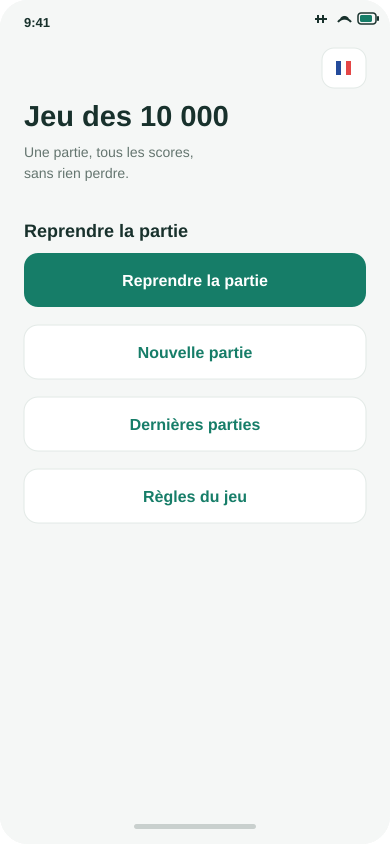
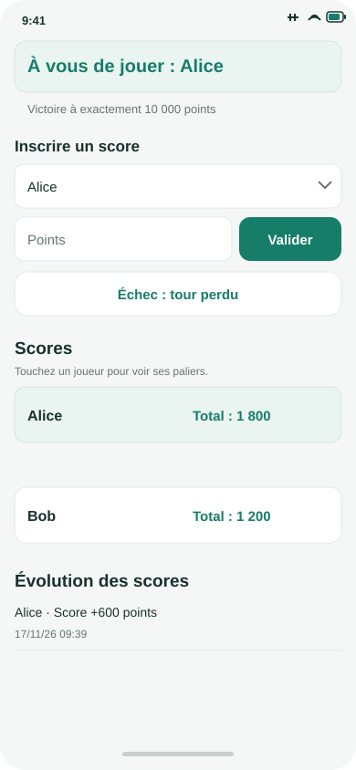
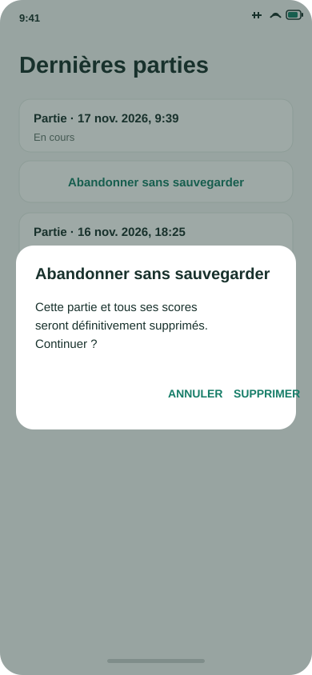

# Jeu des 10 000

**Une application Android simple et hors ligne pour suivre vos parties de dés.**

Créez une partie, saisissez les scores au fil des tours et laissez l’application
gérer les totaux, les paliers, les égalités et la fin de partie. Les dés et les
combinaisons sont gérés par les joueurs : l’application se concentre sur le
suivi du jeu.

| Caractéristique | Détail |
|---|---|
| Plateforme | Android |
| Joueurs | De 2 à 8 |
| Version actuelle | 1.9 |
| Langues | Français, anglais et espagnol |
| Version minimale d’Android | Android 6.0 (API 23) |

## Fonctionnalités

- Démarrer une partie ou reprendre la partie en cours.
- Saisir un score, enregistrer un échec ou effectuer une correction manuelle.
- Suivre les scores, les paliers et les échecs de chaque joueur.
- Appliquer la règle du vol de points en cas d’égalité, y compris les cascades
  entre plusieurs joueurs, et afficher un récapitulatif des points retirés.
- Consulter le détail des scores et l’historique des parties.
- Abandonner une partie en cours ou supprimer une partie terminée depuis
  l’historique, après confirmation.
- Terminer une partie à exactement 10 000 points ; afficher le vainqueur et
  empêcher la reprise ou la modification d’une partie terminée.
- Changer de langue depuis le bouton drapeau de l’écran d’accueil.

## Aperçu de l’application

Illustrations des écrans principaux de l’application.

<p align="center">
  
  
  
</p>

Les variantes du jeu des 10 000 sont nombreuses. Les règles suivies par
l’application sont décrites dans [REGLES.md](./REGLES.md).

## Télécharger et installer

La version courante est disponible ici :

**[Télécharger l’APK de test 1.9](https://github.com/furcy75/Jeu_des_10000/releases/download/v1.9/jeu-des-10000-v1.9-debug.apk)**

Il s’agit d’un APK **debug**, destiné aux tests et non signé pour une
distribution de production. Pour l’installer avec Android Debug Bridge (ADB),
connectez un appareil Android avec le débogage USB activé, puis lancez :

```sh
adb install -r apk/jeu-des-10000-v1.9-debug.apk
```

Les anciennes versions de test sont conservées dans [`apk/`](./apk/).

## Compiler depuis les sources

### Prérequis

- JDK 17 ou 21
- Android SDK avec Android SDK Platform 35
- ADB, uniquement pour installer l’application depuis la ligne de commande

Clonez le dépôt et compilez l’APK debug :

```sh
git clone https://github.com/furcy75/Jeu_des_10000.git
cd Jeu_des_10000
./gradlew assembleDebug
```

Sous Windows, utilisez `gradlew.bat assembleDebug`.

L’APK généré se trouve à l’emplacement suivant :

```text
app/build/outputs/apk/debug/app-debug.apk
```

Pour compiler l’application et lancer la tâche de tests unitaires :

```sh
./gradlew testDebugUnitTest assembleDebug
```

Le projet ne contient actuellement pas de tests unitaires.

Le projet utilise le wrapper Gradle fourni ; Gradle et les dépendances de
construction peuvent être téléchargés lors du premier build.

## Principes de jeu pris en charge

- L’ouverture nécessite au moins **600 points en un tour**. Si le total d’un
  joueur retombe à 0 ou moins, il doit ouvrir à nouveau.
- La victoire exige d’atteindre **exactement 10 000 points**. Dépasser le total
  compte comme un échec et les points du tour ne sont pas ajoutés.
- Au troisième échec d’un palier, le gain de ce palier est retiré.
- Si un joueur rejoint exactement le total d’un adversaire, le dernier gain
  réussi de cet adversaire est retiré. Toute nouvelle égalité est résolue en
  cascade ; un même gain ne peut être retiré qu’une fois.
- Une partie gagnée est clôturée. Son vainqueur et son état restent visibles
  dans l’historique.

Les combinaisons de dés sont saisies manuellement. Consultez
[les règles détaillées](./REGLES.md) et mettez-vous d’accord sur les éventuelles
variantes avant la partie.

## Confidentialité

L’application fonctionne hors ligne. Les noms des joueurs, parties et scores
sont conservés localement dans la base de données privée de l’application sur
l’appareil. L’application ne requiert ni compte ni connexion réseau.

## Licence

Ce projet est distribué sous les termes de la
[GNU General Public License, version 3](./LICENSE) (GPL-3.0).

## Contribuer

Les [suggestions et signalements de bogues](https://github.com/furcy75/Jeu_des_10000/issues)
sont les bienvenus. Pour proposer une modification, ouvrez une
[pull request](https://github.com/furcy75/Jeu_des_10000/pulls) en décrivant le
changement et les vérifications effectuées.
